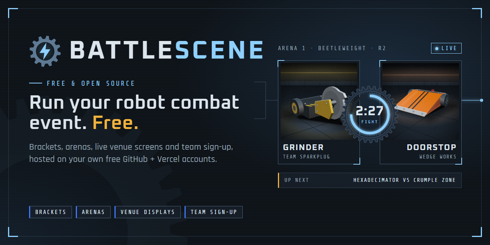
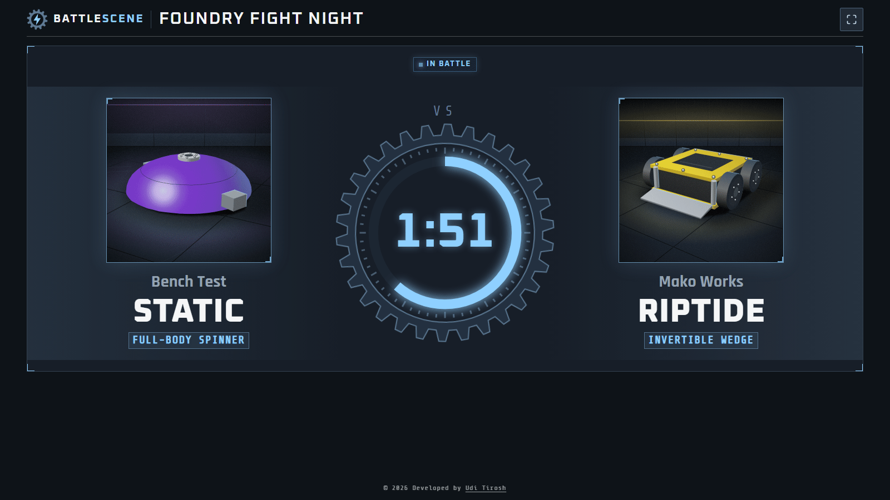
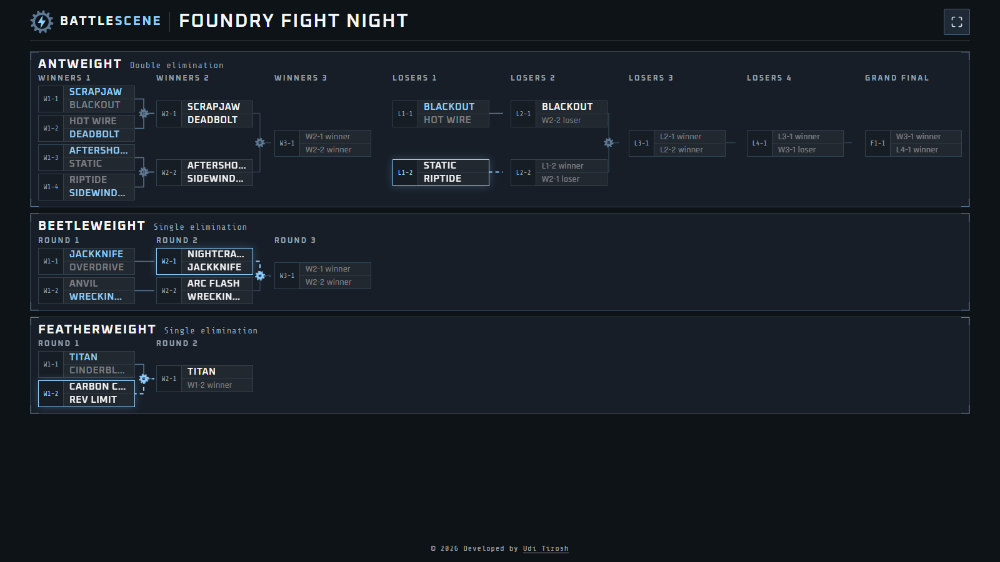
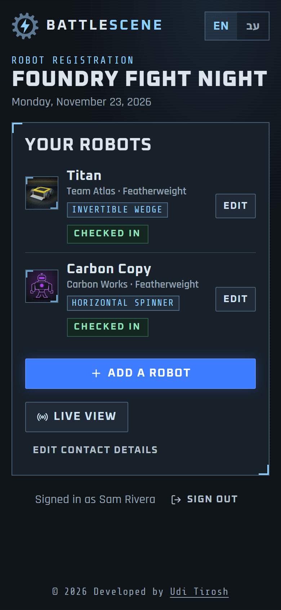

<p align="center"></p>

# BattleScene

**Free, open-source event software for robot combat communities.** BattleScene runs your meetup's brackets, arenas, venue screens, and team sign-up. You host your own copy on free GitHub and Vercel accounts, so there are no fees or subscriptions, and your event data stays yours.

If you run a robot combat club or meetup, this README walks you through getting your own copy online in about 20 minutes, with no coding.

| On the venue TV | Every bracket, live | Teams sign up by phone |
|---|---|---|
|  |  |  |

## What you get

- **Weight classes, each with its own arena.** Run several classes and arenas in parallel on the same day.
- **Three bracket formats:** single elimination, double elimination, and *Rounds (2 losses out)*. Teammates are kept apart in the opening battles.
- **Event-day tools:** a check-in desk, a battle queue with holds and reordering, battle timers, last calls with forfeits, and withdrawals.
- **Venue displays and spectator links:** up to 10 TV displays per meetup (Ringmaster view, All ladders, a single arena, In battle), a public link and QR code for spectators' phones, and your own logo and colors.
- **Team self-registration:** a secret link or QR code, Google sign-in, robot photos and weapon types, and a garage that remembers each team's robots for the next meetup.
- **English and Hebrew** spectator displays (right-to-left aware).
- **A staff team:** add managers by their Google address. Every change is recorded in an activity log.

## Run your own BattleScene (free)

### What you need

- A **GitHub** account ([sign up](https://github.com/signup)).
- A **Vercel** account on the free Hobby plan ([sign up](https://vercel.com/signup), choosing **Continue with GitHub**).
- A **Google** account, to create the "Sign in with Google" client in Google Cloud Console.

You don't need a server, and you won't write any code.

### Step 1: Pick a project name

Your site's address will be `https://<project-name>.vercel.app`, for example `https://robot-club-events.vercel.app`. Pick a name now, because the Google step needs the address. Something specific to your club is more likely to be free. You can [check the result and fix it later](#step-4-sign-in-and-invite-your-staff) if Vercel gives you a different address.

### Step 2: Set up Google sign-in

Staff and teams sign in with their Google accounts. To allow that, create an OAuth client:

1. Open [Google Cloud Console](https://console.cloud.google.com/) and create a new project (for example, "BattleScene").
2. Go to **APIs & Services → OAuth consent screen** (also called **Google Auth Platform**). Enter an app name and support email, choose the **External** audience, and finish the setup.
3. On the **Audience** page, select **Publish app** so the status reads **In production**. While the app is in testing mode, only the Google accounts listed as test users can sign in. BattleScene asks only for the basic `openid email profile` scopes, which don't need Google verification.
4. Go to **Clients → Create client**, choose **Web application**, and under **Authorized redirect URIs** add:

   ```
   https://<project-name>.vercel.app/api/auth/callback
   ```

5. Create the client and copy its **Client ID** and **Client secret**.

### Step 3: Deploy

#### Option A: The Deploy button (fastest)

[](https://vercel.com/new/clone?repository-url=https%3A%2F%2Fgithub.com%2Fiollama%2FBattleScene&project-name=battlescene&repository-name=battlescene&env=APP_ORIGIN%2CGOOGLE_CLIENT_ID%2CGOOGLE_CLIENT_SECRET%2CSESSION_SECRET%2CBOOTSTRAP_ADMIN_EMAIL&envDescription=Your%20site%20address%2C%20Google%20sign-in%20client%2C%20a%20session%20secret%2C%20and%20the%20admin%20Google%20address.&envLink=https%3A%2F%2Fgithub.com%2Fiollama%2FBattleScene%23environment-variables&stores=%5B%7B%22type%22%3A%22blob%22%2C%22access%22%3A%22private%22%7D%5D)

The button copies this repository into your GitHub account, creates the Vercel project, and adds a **private** Blob store for your data. When it asks:

1. Change the project name to the one you picked in step 1.
2. Create the Blob store it offers (keep it **private**).
3. Fill in the five [environment variables](#environment-variables), then select **Deploy**.

The copy the button makes is a new repository, not a fork. To get updates later, see [Keeping up to date](#keeping-up-to-date).

#### Option B: Fork and import (easiest to keep updated)

1. Select **Fork** at the top of this page to copy the repository into your GitHub account.
2. In Vercel, select **Add New… → Project**, import your fork, and set the project name you picked in step 1. Leave the build settings as they are.
3. Before deploying, open **Environment Variables** and add the five [environment variables](#environment-variables). Then select **Deploy**.
4. In the new project, open **Storage → Create Database → Blob**. Choose **Private** access and connect the store to the project.
5. Open **Deployments**, and on the latest deployment select **⋯ → Redeploy** so it picks up the storage connection.

#### Environment variables

| Name | What to enter |
|---|---|
| `APP_ORIGIN` | Your site address with no trailing slash, e.g. `https://robot-club-events.vercel.app` |
| `GOOGLE_CLIENT_ID` | The Client ID from step 2 |
| `GOOGLE_CLIENT_SECRET` | The Client secret from step 2 |
| `SESSION_SECRET` | A random string of **at least 32 characters**. Generate one with `openssl rand -base64 32`, or with a password manager's generator. |
| `BOOTSTRAP_ADMIN_EMAIL` | The Google address of the person who runs the whole site (the super admin) |

The Blob store sets its own variable (`BLOB_READ_WRITE_TOKEN` or `BLOB_STORE_ID`) when it's connected. You don't add that one yourself.

### Step 4: Sign in and invite your staff

1. Open your site. If Vercel gave it a different address than the one you picked, update `APP_ORIGIN` (Vercel **Settings → Environment Variables**) and the Google redirect URI to match, then redeploy.
2. Sign in with the `BOOTSTRAP_ADMIN_EMAIL` account. You're the super admin.
3. Create your first meetup. To practise first, use **Fill with demo data** in **Robots & classes**.
4. Add the rest of your team under **General settings → Global manager access** by entering their Google addresses.

The [organizer's guide](docs/GUIDE.md) covers running the event itself.

### Keeping up to date

- **If you forked (option B):** when this repository gets updates, open your fork on GitHub and select **Sync fork → Update branch**. Vercel redeploys automatically.
- **If you used the button (option A):** your copy isn't linked to this repository. Pull updates with git (`git remote add upstream https://github.com/iollama/BattleScene.git`, then `git pull upstream main` and push), or switch to a fork.

Your meetups live in your Blob store, not in the code, so updating never touches your data.

### What it costs

Nothing for a typical club. Vercel's **Hobby** plan, its included Vercel Blob storage, and Google sign-in are all free, and a meetup uses only a small amount of storage and traffic. Two things to know:

- Vercel's [terms](https://vercel.com/legal/terms) allow the Hobby plan only for **personal or non-commercial** use. If your events are run as a business, you might need the Pro plan; see the [Hobby plan](https://vercel.com/docs/plans/hobby) and [fair use guidelines](https://vercel.com/docs/limits/fair-use-guidelines).
- The free allowances have limits ([Blob usage and pricing](https://vercel.com/docs/vercel-blob/usage-and-pricing)). Robot photos are compressed on the phone before upload to keep storage small.

<details>
<summary><strong>Troubleshooting and advanced setup</strong></summary>

- **"Only test users can sign in" or `access_denied` from Google:** the consent screen is still in testing. Publish it (step 2.3).
- **`redirect_uri_mismatch` from Google:** the redirect URI on the Google client must be exactly `APP_ORIGIN` + `/api/auth/callback`.
- **The site says sign-in needs deployment credentials:** one of the five environment variables is missing, or `SESSION_SECRET` is shorter than 32 characters. Fix it in Vercel and redeploy.
- **Storage errors (503):** no Blob store is connected. Connect one under **Storage** and redeploy.
- **Blob store linking:** either way of linking works. A read-write token sets `BLOB_READ_WRITE_TOKEN`. A store linked through the project's OIDC identity sets `BLOB_STORE_ID`. If both are set, the app uses the token.
- **Preview deployments:** use a separate Blob store for preview deployments that need live storage, so tests don't touch your real meetups.
- **Custom domain:** after adding it in Vercel, set `APP_ORIGIN` to the new address, add the matching redirect URI on the Google client, and redeploy.
- **Changing the super admin:** update `BOOTSTRAP_ADMIN_EMAIL` and redeploy.

</details>

## Running an event

1. **Set up:** create a meetup, add weight classes (each gets an arena and a bracket format), and add robots or open **Team registration** and share the link.
2. **Check in:** on the day, check robots in as they arrive at the **Check-in** desk.
3. **Brackets:** generate each class's bracket from the checked-in robots.
4. **Fight:** in **Arenas**, start battles, run the timer, call late robots, and record winners. The brackets advance on their own.
5. **Show it:** publish the meetup, put displays on the venue TVs, and share the spectator link or QR code.
6. **Wrap up:** mark the meetup complete. The results stay online.

The full walkthrough is in the [organizer's guide](docs/GUIDE.md), and every behavior is specified in [docs/SPEC.md](docs/SPEC.md).

## Try it on your computer

With Node.js 26 installed:

```sh
npm ci
npm run dev
```

Open http://127.0.0.1:5173/. Without Google settings, the app runs in demo mode with a sample meetup. No accounts are needed. See [docs/DEVELOPMENT.md](docs/DEVELOPMENT.md) for tests, local Google sign-in, and how the code is organized.

## Contributing

Bug reports, ideas, and pull requests are welcome. Please open an issue first for larger changes. [docs/DEVELOPMENT.md](docs/DEVELOPMENT.md) explains how to run and test the code.

## License

[MIT](LICENSE). Free to use, change, and share. Developed by [Udi Tirosh](https://iollama.com).
